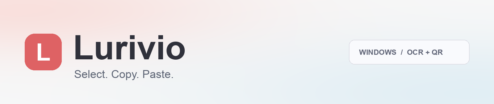
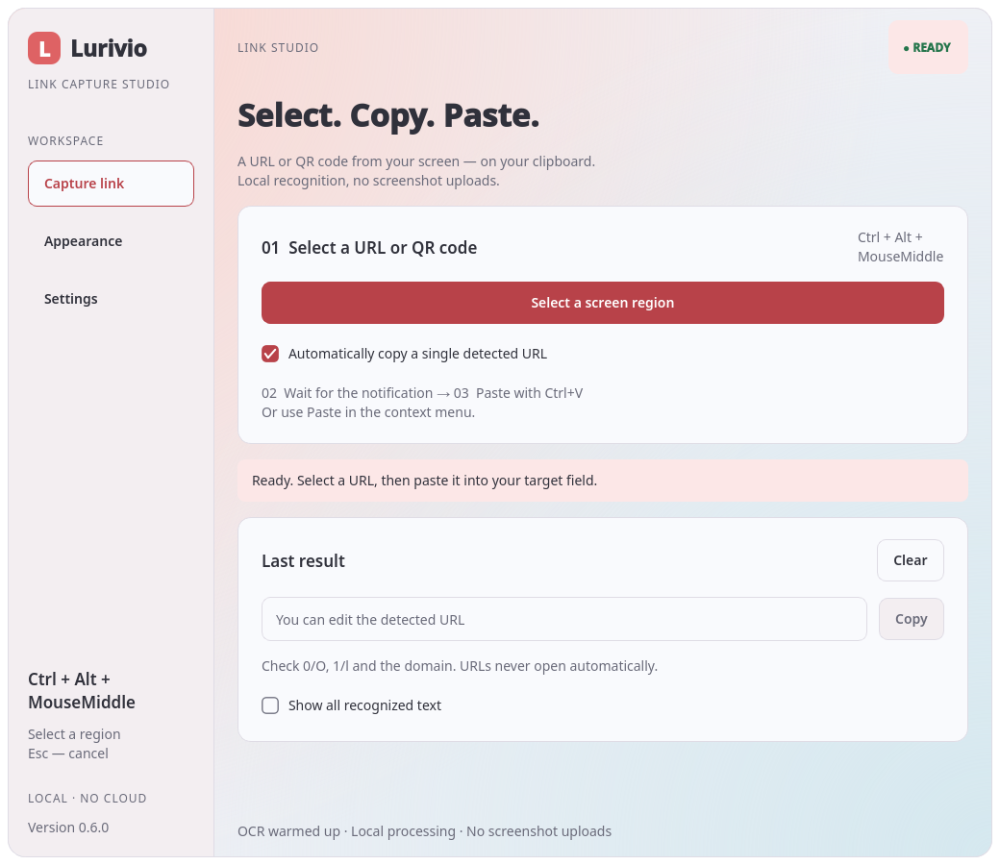
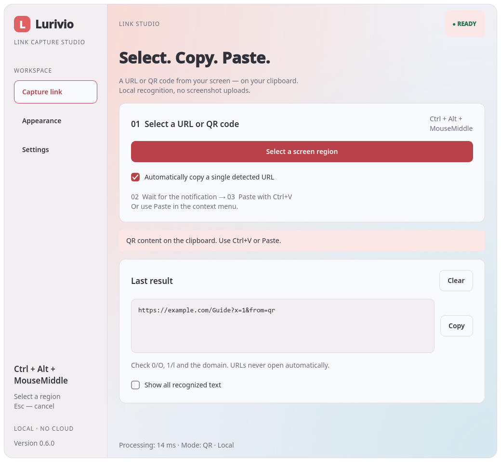
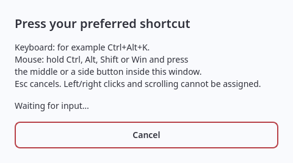
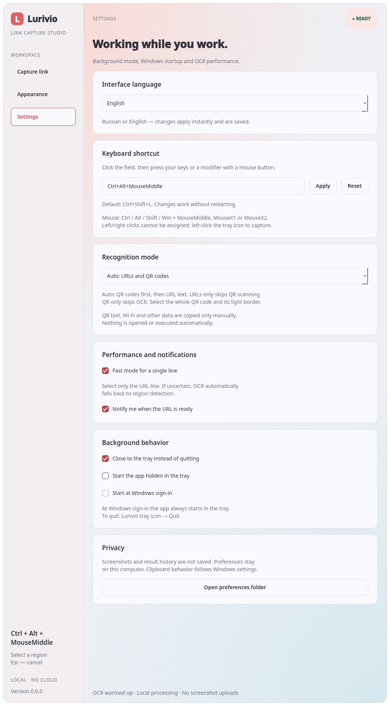
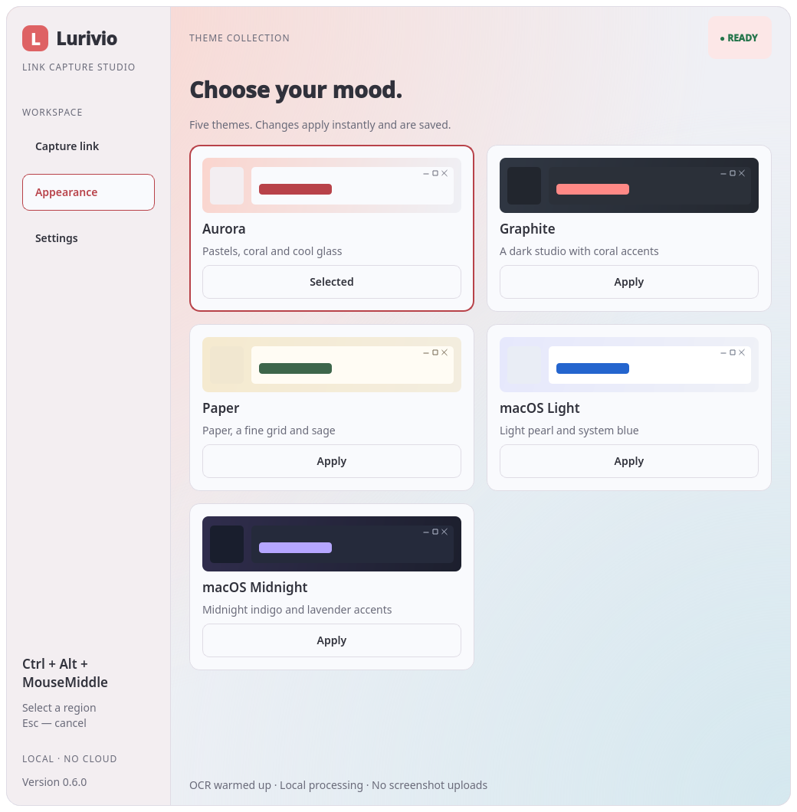

<p align="center">
  
</p>
<p align="center">
  <strong>Ссылки и QR-коды с экрана — в вашем буфере обмена.</strong><br />
  Windows · Локальное OCR + QR · Русский / English · Пять тем
</p>
<p align="center">
  <a href="#быстрый-старт">Быстрый старт</a> ·
  <a href="#qr-коды">QR-коды</a> ·
  <a href="docs/PUBLISHING_RU.md">Публикация</a> ·
  <a href="README.en.md">English</a>
</p>



## Выдели. Скопируй. Вставь.

Не перепечатывайте адрес из видео, картинки или презентации. Нажмите горячую
клавишу, выделите область экрана и вставьте результат через **Ctrl+V**.
QR-коды считываются с того же экрана — камера и загрузка изображения не нужны.

| Выделите | Распознайте | Вставьте |
| :-- | :-- | :-- |
| **Ctrl+Shift+L** или своя комбинация | Локальное OCR или QR | **Ctrl+V** / **«Вставить»** |

> **0.6.1 · Beta / release candidate.** Ранее приложение называлось ScreenLink.
> Локальные проверки выполнялись на Linux / Qt offscreen. Реальный Windows-захват,
> трей, горячие клавиши, глобальные кнопки мыши, DPI и автозапуск ещё требуют проверки на Windows.
> Windows EXE появляется после успешной сборки; готового бинарника в исходниках нет.

## Возможности

- **Ссылки с экрана.** OCR для видимых HTTP/HTTPS-адресов, включая адреса без протокола.
- **QR-коды.** Один или несколько кодов; URL, текст, Wi-Fi и многострочные данные UTF-8.
- **Три режима.** Авто, только ссылки (OCR), только QR-коды.
- **Быстрый OCR.** Постоянный прогретый движок, быстрый путь для строки, кэш последнего точного выделения в памяти.
- **Сочетание клавиш или мыши.** Нажатия записываются, вручную печатать не нужно; изменение без перезапуска; занятая клавиатурная комбинация не заменяет прежнюю рабочую.
- **Фоновая работа.** Трей, уведомления и необязательный автозапуск при входе в Windows.
- **RU / EN.** Язык меняется сразу и сохраняется; распознанные данные не переводятся.
- **Пять тем.** Aurora, Graphite, Paper, macOS Light и macOS Midnight.
- **Нативное окно Windows.** Кнопки справа сверху; сворачивание в панель задач, закрытие учитывает настройку трея.

## Быстрый старт

### Готовая Windows-сборка

Если в **Releases** опубликован `Lurivio-Windows.zip`:

1. Скачайте архив из доверенного репозитория и полностью распакуйте.
2. Откройте папку `Lurivio` и запустите `Lurivio.exe`.
3. Не отделяйте EXE от папки `_internal` и остальных файлов.

Сборка неподписанная. Не отключайте защиту Windows ради запуска.
При отсутствии проверенного бинарного релиза используйте исходники.

### Из исходников

**Windows 10/11 x64 · Python 3.11 x64 · Python launcher (`py`).**

1. Скачайте **Code → Download ZIP**, полностью распакуйте.
2. Установите [Python 3.11 x64](https://www.python.org/downloads/release/python-3119/), если нужно.
3. Запустите **`Start.bat`**. Первая установка библиотек требует интернета.

Для разработчиков:

```powershell
py -3.11 -m venv .venv
.\.venv\Scripts\python.exe -m pip install -r requirements.txt
.\.venv\Scripts\python.exe app.py
```

Ошибка запуска? Откройте `Diagnose.bat`.

## QR-коды

**Исправление 0.6.1:** основной декодер заменён на ZXing-C++ с OpenCV в резерве.
Добавлены обработка светлой рамки, инверсии и запасной путь для округлённых модулей.
Оригинальный кадр проверяется до уменьшения: мелкие/плотные элементы не теряются из-за предварительного сжатия.


1. В настройках выберите **Авто** или **Только QR-коды**.
2. Нажмите горячую клавишу и выделите **весь QR-код вместе со светлой рамкой**.
3. Единственная корректная HTTP/HTTPS-ссылка копируется автоматически, если включён автокопирующий режим.
4. Несколько результатов — выберите нужный в списке и нажмите **«Копировать»**.
5. Обычный текст, Wi-Fi, контакты и другие схемы требуют ручного копирования после просмотра.



**Авто:** если найден QR, показываются его данные; OCR в этом выделении не запускается.
Если QR не найден, выполняется OCR ссылок. Видимый текст рядом с QR одновременно
не объединяется с QR-результатом. Очень узкая область строки в режиме «Авто» пропускает QR-проверку.
**Только ссылки** исключает накладные расходы QR. **Только QR** исключает OCR для выделения
(модель OCR всё равно прогревается при старте приложения).

Поддерживаются текстовые QR-коды UTF-8, не произвольные бинарные данные и не другие
штрихкоды. Слишком мелкие, повреждённые или частично обрезанные коды могут не считываться.
Программа **не подключает Wi-Fi, не открывает URL и не выполняет содержимое QR**.
Проверяйте адрес перед открытием и данные перед вставкой, особенно в терминал.

## Настройки

- **Язык интерфейса → English / Русский** — без перезапуска.
- **Горячая клавиша → нажмите поле → нажмите сочетание → Применить**. Текст вводить не нужно. По умолчанию Ctrl+Shift+L; сброс доступен.
- Ctrl+C/X/V и F12 нельзя назначить на захват; занятые комбинации не заменяют рабочую.
- **Мышь:** Ctrl / Alt / Shift / Win + нажатие колёсика (`MouseMiddle`) либо боковая кнопка (`MouseX1` / `MouseX2`). Нажимайте внутри окна записи. ЛКМ, ПКМ, прокрутка и кнопка без модификатора не назначаются. Esc отменяет запись.
- **Трей:** один ЛКМ сразу запускает выделение; ПКМ → «Открыть Lurivio» открывает интерфейс. Нажатие уведомления по-прежнему открывает результат.
- **Режим распознавания** — авто / OCR / QR.
- **Сразу копировать единственную найденную ссылку** — только безопасный формат HTTP/HTTPS, не гарантия безопасности сайта.
- **Закрывать окно в трей** — по умолчанию включено. Полный выход: значок Lurivio → **Завершить**.
- **Запускать при входе в Windows** — по выбору пользователя; старт скрыто в трее.





**Esc** / правая кнопка отменяет выделение без изменения буфера.
Приложение не нажимает Ctrl+V за вас и не отправляет поисковые запросы.

## Обновление со ScreenLink

1. В старой программе выключите автозапуск, затем полностью завершите её через трей.
2. Распакуйте Lurivio. При замене файлов можно сохранить `.venv`; `Start.bat` обновит зависимости.
3. На первом запуске при отсутствии новых настроек читаются только настройки из старой папки ScreenLink.
4. В новой программе отдельно включите автозапуск. Старую запись автозапуска приложение не удаляет автоматически.

Настройки Lurivio: `%LOCALAPPDATA%\Lurivio\settings.json`.
Старые настройки не удаляются; история, изображения и журналы не мигрируют.

## Приватность и ограничения

Распознавание выполняется на компьютере. Приложение не отправляет снимки или QR на сервер,
не сохраняет снимки и историю результатов. Последний результат и один кэш находятся в памяти.
«Очистить» очищает их, но не изменяет буфер Windows. История/облачная синхронизация буфера
подчиняется настройкам Windows. Настройки и технический `errors.log` хранятся локально. Для глобального сочетания мыши используется Windows mouse hook; движения и история нажатий не сохраняются. Сочетания мыши не имеют эксклюзивного резервирования: драйвер или другая программа может перехватывать их.

OCR может ошибаться в `0/O`, `1/l`, регистре и символах URL. Защищённое видео и экраны входа
могут быть недоступны для захвата. Выделение ограничено монитором под указателем.
Скриншоты показывают интерфейс 0.6.0: в 0.6.1 он сохранён, изменён QR-движок. Снимки показывают клиентскую область; системную панель Windows добавляет ОС.

## Темы



Самостоятельный интерфейс Qt с пастельными, тёмными и бумажными темами.
Не официальный продукт Apple или Nami; название macOS относится только к стилю темы.

## Разработка и релиз

```powershell
$env:LURIVIO_TEST_OCR = "1"
.\.venv\Scripts\python.exe -m unittest discover -s tests -v
```

Локальная сборка: **`Build_EXE.bat`** после установки и завершения приложения.
GitHub Actions проверяет код и собирает Windows x64 portable ZIP.
Тег **v0.6.1** создаёт **черновик предварительного релиза**, а не публичный стабильный релиз.
Публикуйте его только после проверки Windows-сборки.

- [Как опубликовать](docs/PUBLISHING_RU.md)
- [Чек-лист перед релизом](docs/RELEASE_CHECKLIST_RU.md)
- [Проверки и ограничения](docs/TESTING_RU.md)
- [Производительность](docs/PERFORMANCE_RU.md)
- [Руководство](docs/USER_GUIDE_RU.md)
- [Изменения](CHANGELOG.md) · [Участие](CONTRIBUTING.md) · [Безопасность](SECURITY.md)

## Лицензия

Собственный код — [MIT](LICENSE). Сторонние библиотеки и OCR-модели имеют отдельные лицензии:
[THIRD_PARTY_NOTICES.md](THIRD_PARTY_NOTICES.md). Сборка включает доступные тексты лицензий;
это не юридическая гарантия полноты. Название Lurivio зафиксировано для этого проекта,
но регистрация товарного знака и права на домены отдельно не проверены.

[QR troubleshooting / диагностика (RU)](docs/QR_TROUBLESHOOTING_RU.md)
